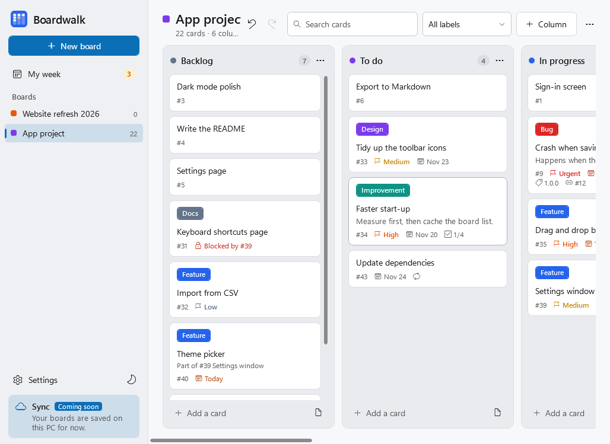
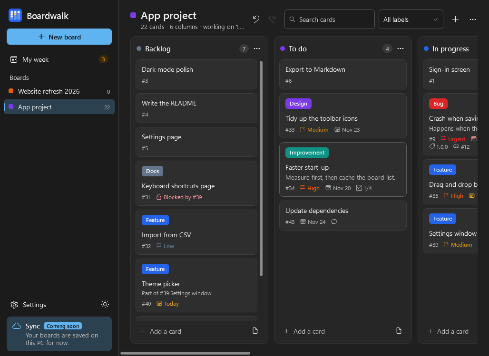
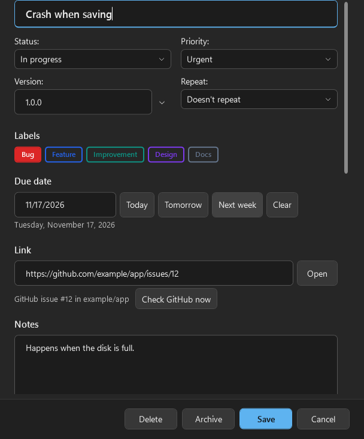
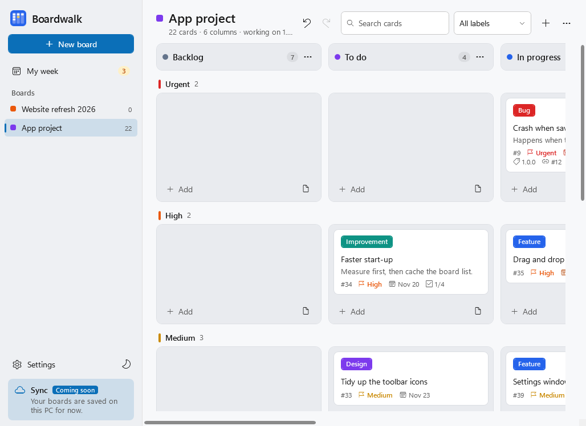
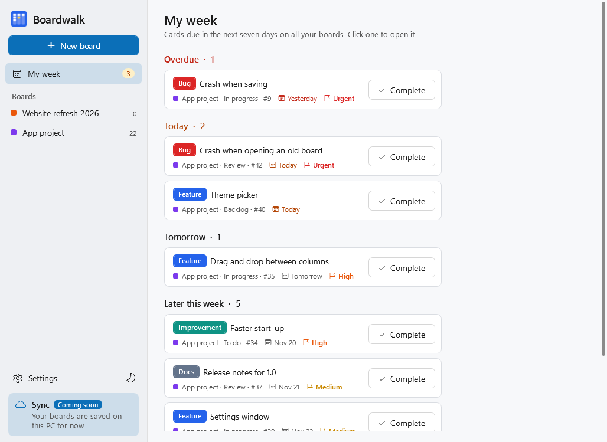
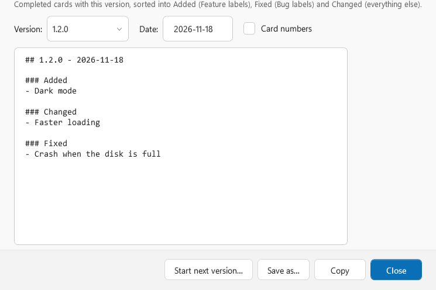
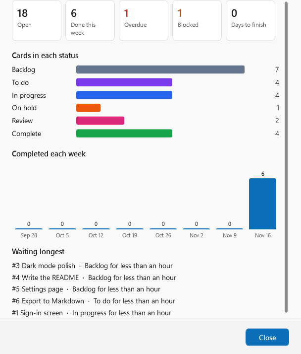

# Boardwalk

Kanban boards for Windows 10 and 11, by **Bytehawk Studio**. Make a board for each project, give it the statuses you work in (New, In progress, On hold, Complete, or your own), and move cards across as work gets done.

| Light | Dark |
|---|---|
|  |  |

Click a card to see everything about it:

## Features

- **As many boards as you like:** one per project, listed in the sidebar with their card counts. Rename, recolour, duplicate (with or without the cards), reorder or delete them.
- **Statuses:** each column is a status with its own colour. New boards start with **New, In progress, On hold and Complete**. Add more from a list (Backlog, To do, Blocked, Review, Testing, Cancelled…) or type your own name. Mark a status as "counts as complete" and its cards get a tick and are never shown as overdue.
- **Templates:** Standard, Software project (with Bug, Feature, Improvement, Design and Docs labels, Bug report and Feature card templates, and a limit on In progress), Personal and Blank.
- **Cards:** a number (#12) you can mention in commits and notes, labels, priority, due date, version, a link, notes, a checklist and attachments.
- **Quick add:** type `Fix crash #bug !high friday` and the label, priority and due date are filled in for you.
- **Undo and redo** (Ctrl+Z / Ctrl+Y) for everything since Boardwalk started, deleted boards included.
- **Drag and drop** cards between statuses and within one. Right-click a card to move it to another status or board, change its labels, priority or repeat, add a sub-task, duplicate, archive or delete it.
- **Blocked by and sub-tasks:** mark a card as waiting on others ("Blocked by #12"), or split it into sub-task cards and watch the count go up.
- **Attachments:** paste a screenshot with Ctrl+V, add files, or drag them onto a card.
- **Card templates:** start bug reports and features the same way every time, and save any card as a template.
- **Repeating cards:** daily, weekly, monthly or yearly; completing one makes the next.
- **My week:** everything due in the next seven days on all your boards, in one list.
- **Reminders:** a Windows notification once a day for cards due today or overdue. Boardwalk can stay in the notification area and start with Windows.
- **Releases:** give cards a version (completed cards can get the version you're working on automatically), then **Write changelog** turns them into a CHANGELOG section with Added, Changed and Fixed.
- **GitHub:** import a repository's open issues as cards, see whether linked issues and pull requests are open, closed or merged, and close an issue when its card is completed. Public repositories need no setup; private ones and closing issues need a token (stored encrypted for your Windows account).
- **Card history and board stats:** see when a card moved and how long it has been waiting, and charts of what's open, overdue, blocked and finished each week.
- **Swimlanes:** rows across the board by priority or by label.
- **Card limits, search and filter, archive and export** (Markdown, files and full backups).
- **Light and Dark mode**, or follow Windows. Seven accent colours, compact cards and three column widths.
- **Saved on your PC:** every change is saved straight away to `%APPDATA%\Boardwalk`, with the previous version kept as a backup.
- **Sync: coming soon.** Syncing boards between your devices is planned for a later version. For now, use Back up and Import to move boards to another PC.

| Swimlanes | My week |
|---|---|
|  |  |

| Write changelog | Board stats |
|---|---|
|  |  |

## Keyboard shortcuts

Ctrl+Shift+N (new board), Ctrl+N (add a card), Ctrl+Z / Ctrl+Y (undo / redo), Ctrl+Shift+W (My week), Ctrl+V in a card (paste a screenshot), Ctrl+F (search), Esc (clear search), F2 (rename board), Ctrl+Tab / Ctrl+Shift+Tab (next / previous board), Ctrl+, (Settings), Shift+mouse wheel (scroll sideways). In the "Add a card" box, Enter adds the card and keeps the box open for the next one.

## Tested on every build

Each push builds Boardwalk on Windows and runs its self-test (60+ checks): boards, templates and statuses, adding, moving and reordering cards, quick add, undo and redo, card limits, labels, due dates, blocked-by, sub-tasks, repeating cards, history, versions and the changelog, GitHub addresses and issue import, attachments, swimlanes, My week and reminders, search and filters, archive, saving and reloading, recovery from a damaged file, export and import, Light, Dark and Follow Windows, and every dialog. Then it installs, launches and uninstalls the setup program. See [BUILD.md](BUILD.md#testing).

## Download

Get **Boardwalk-x.y.z-Setup.exe** (installer) or the portable **.zip** from [Releases](https://github.com/adamglassner/boardwalk/releases), or install it from the Bytehawk Studio Launcher.

## What's new

See [CHANGELOG.md](CHANGELOG.md). The current version's notes are also in Boardwalk under Settings › About.

## Building

See [BUILD.md](BUILD.md).

© 2026 Bytehawk Studio
