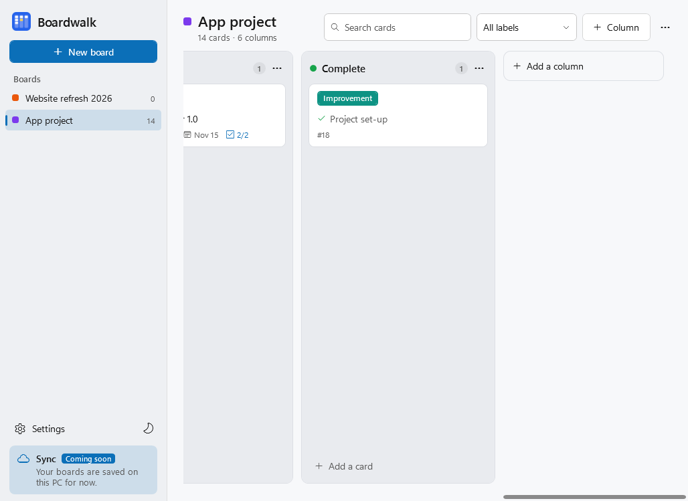
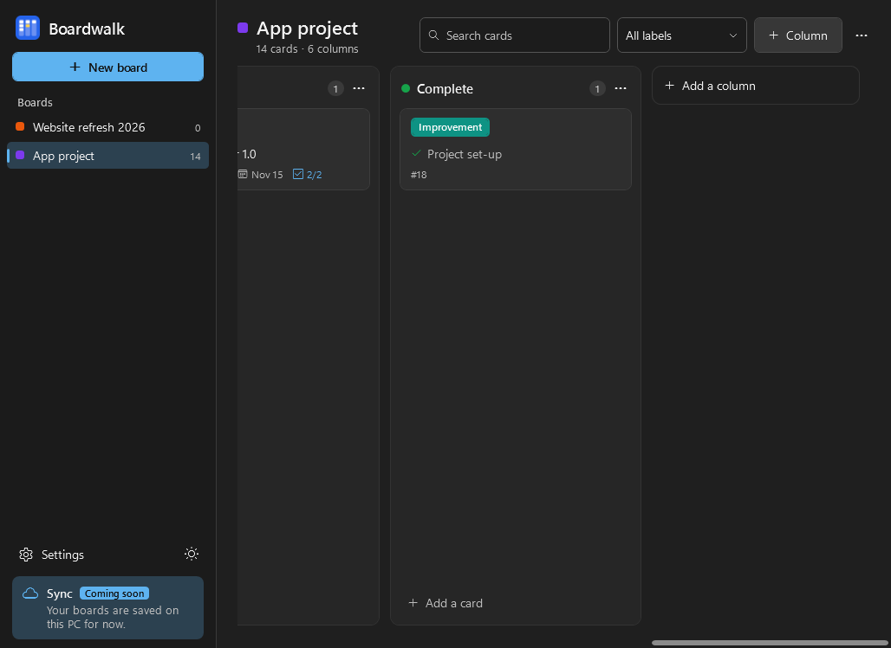

# Boardwalk

Kanban boards for Windows 10 and 11, by **Bytehawk Studio**. Make a board for each project, give it the statuses you work in (New, In progress, On hold, Complete, or your own), and move cards across as work gets done.

| Light | Dark |
|---|---|
|  |  |

## Features

- **As many boards as you like:** one per project, listed in the sidebar with their card counts. Rename, recolour, duplicate (with or without the cards), reorder or delete them.
- **Statuses:** each column is a status with its own colour. New boards start with **New, In progress, On hold and Complete**. Add more from a list (Backlog, To do, Blocked, Review, Testing, Cancelled…) or type your own name. Mark a status as "counts as complete" and its cards get a tick and are never shown as overdue.
- **Templates:** Standard, Software project (with Bug, Feature, Improvement, Design and Docs labels and a limit on In progress), Personal and Blank.
- **Cards:** a number (#12) you can mention in commits and notes, labels, priority (Low, Medium, High, Urgent), due date, a link (an issue, pull request or document), notes and a checklist.
- **Drag and drop** cards between statuses and within one. Right-click a card to move it to another status or another board, change its labels or priority, duplicate, archive or delete it.
- **Card limits:** give a status a limit and its count turns orange when there are too many cards in it.
- **Search and filter:** search titles, notes, checklists and labels, or type `#12` to find a card by number. Filter by label.
- **Archive:** hide finished cards without deleting them, then restore them from Board options › Archived cards.
- **Export:** copy a board as Markdown, save it as a `.md` file, export or import boards as files, and back up all your boards at once.
- **Light and Dark mode**, or follow Windows. Seven accent colours, a Light/Dark button in the sidebar, compact cards and three column widths.
- **Saved on your PC:** every change is saved straight away to `%APPDATA%\Boardwalk\boards.json`, with the previous version kept as a backup.
- **Sync: coming soon.** Syncing boards between your devices is planned for a later version. For now, use Back up and Import to move boards to another PC.

## Keyboard shortcuts

Ctrl+Shift+N (new board), Ctrl+N (add a card), Ctrl+F (search), Esc (clear search), F2 (rename board), Ctrl+Tab / Ctrl+Shift+Tab (next / previous board), Ctrl+, (Settings), Shift+mouse wheel (scroll sideways). In the "Add a card" box, Enter adds the card and keeps the box open for the next one.

## Tested on every build

Each push builds Boardwalk on Windows and runs its self-test (40+ checks): boards, templates and statuses, adding, moving and reordering cards, card limits, labels, due dates, search and filters, archive, moving cards between boards, saving and reloading, recovery from a damaged file, Markdown and file export and import, Light, Dark and Follow Windows, and every dialog. Then it installs, launches and uninstalls the setup program. See [BUILD.md](BUILD.md#testing).

## Download

Get **Boardwalk-x.y.z-Setup.exe** (installer) or the portable **.zip** from [Releases](https://github.com/adamglassner/boardwalk/releases), or install it from the Bytehawk Studio Launcher.

## What's new

See [CHANGELOG.md](CHANGELOG.md). The current version's notes are also in Boardwalk under Settings › About.

## Building

See [BUILD.md](BUILD.md).

© 2026 Bytehawk Studio
